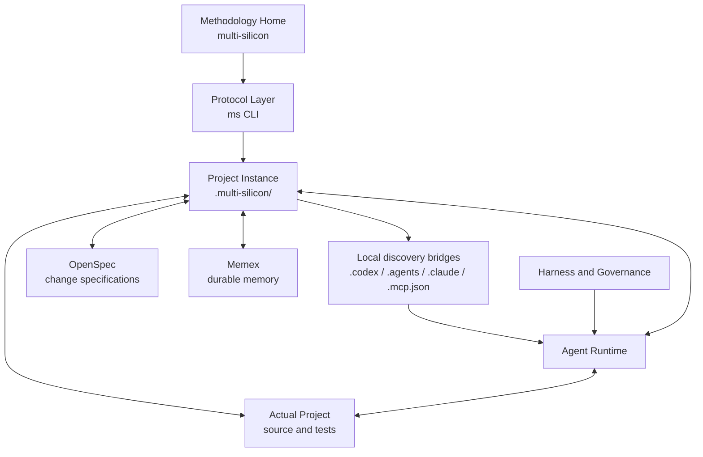

# Multi-Silicon 总体架构

## 目标

Multi-Silicon 要建立的不是一个孤立工具，而是一套可渐进应用于真实软件工作的 Silicon Team 运行模式。人类保留目标、架构边界与 go/no-go 权限，系统逐步承担记忆、规格化、执行、独立审查、协调和有边界迭代。

## 系统边界



### Methodology Home

本仓库保存可版本化、可分发的公共能力：

- 从文章体系提炼的能力地图；
- `ms` CLI 与稳定 Protocol；
- Memory、Harness、Agent 和 Run 的公共 Skill 与模板；
- 虚构示例、测试与公开安全检查。

它不保存任何实际项目的事实和运行状态。

### Project Instance

每个实际项目通过 `ms init [path]` 创建 `.multi-silicon/`。它是项目消费 Multi-Silicon 的唯一实例边界，保存：

- 项目级配置；
- Memex Memory；
- Agent 要求、MCP、项目局部 Skill 与 Harness 的规范来源；
- 未来多 Agent 和自主运行的状态。

默认采用本地模式，并加入目标 Git 仓库的本地 exclude。由于 Codex 与 Claude 只在各自约定目录发现项目配置，`ms init` 会生成少量本地薄桥接；规范内容仍以 `.multi-silicon/` 为准。MCP/Hook 必需桥接若已被项目跟踪或包含不同内容，初始化会明确失败；Skill 目录桥接冲突时保留项目文件并退化为 Hook 注入，任何情况都不覆盖项目配置。

## 三种知识状态

| 状态 | 位置 | 作用 |
|---|---|---|
| 当前事实 | 实际项目源码、测试和文档 | 决定现在真实存在什么 |
| 项目经验 | `.multi-silicon/memory` | 帮助未来任务召回决策、因果关系和陷阱 |
| 公共方法 | Methodology Home | 向不同项目提供通用 Protocol、Skill 和 Harness |

项目经验不会自动进入公共方法。只有反复验证、完成脱敏并能跨项目复用的知识，才允许晋升。

## 工具职责

| 工具 | 职责 | 不负责 |
|---|---|---|
| Multi-Silicon | 总体工作模式、能力路线图、项目消费协议 | 具体项目事实 |
| OpenSpec | 单个变更的 proposal、spec、design、tasks | 产品愿景与长期记忆 |
| Memex | 卡片搜索、读取、写入、链接和持久化 | Agent 语义决策与任务编排 |

## CLI 协议

一级命令只放跨能力操作：

```text
ms init
ms status
ms doctor
ms upgrade
```

增长型功能按能力域组织：

```text
ms memory ...
ms lifecycle ...
ms harness ...
ms agent ...
ms run ...
```

当前实现承诺 `init`、`status`、`doctor`、`memory` 与内部生命周期协议 `lifecycle`。其余命令按照 [路线图](../ROADMAP.md) 渐进交付。
